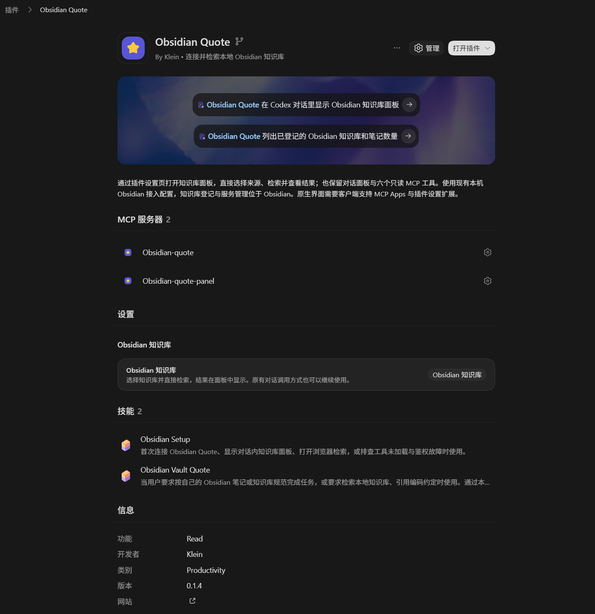
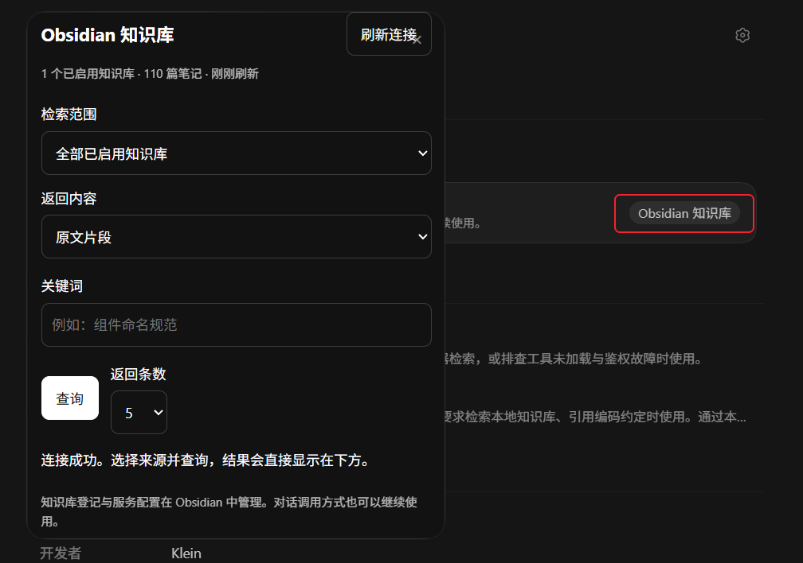
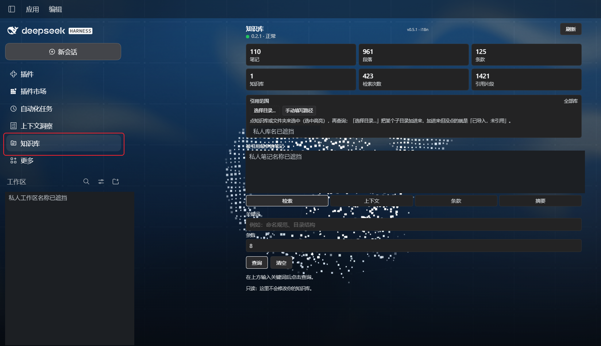

# Vault Quote

Vault Quote connects local Markdown vaults to AI coding assistants as read-only reference sources. Register local folders, including folders outside the currently open vault, then choose one or several paths in the Codex panel for each query. The repository and AI-client integrations retain the **Obsidian Quote** brand; the community desktop plugin is **Vault Quote**, with ID **`vault-quote`**.

Install and enable the desktop plugin first, register your vaults, and explicitly write the local connection configuration. Install the appropriate client integration separately: DeepSeek Harness provides its own sidebar, Codex has a settings panel where supported, and other local MCP clients can use six retrieval tools. Keep the desktop application running. Installing a client integration does not install the desktop plugin or copy your notes.

Indexing and search run locally. The service listens on loopback and authenticates data requests. Only requested results are returned; an AI client may subsequently send those results to its model provider. The desktop plugin uses Node filesystem APIs to read explicitly registered vaults and can write its own settings, citation ledger and user-requested connection files. It does not modify note contents. See [Security](SECURITY.md), [client setup](docs/HARNESS-USAGE.md), and [contributing](CONTRIBUTING.md) for boundaries and development instructions.

把多个本地 Obsidian 知识库接成 AI 编码助手的只读参考资料。按需检索笔记、提取编码规则、生成带来源的上下文和项目规范摘要，提供浏览器面板、命令行与 MCP 接口。

Obsidian 社区插件名称为 **Vault Quote**，ID 为 **`vault-quote`**，桌面插件版本 **0.2.9**；项目与各 AI 客户端继续使用 **Obsidian Quote** 品牌。DeepSeek Harness 面板为 **0.5.1**，Codex 接入 **0.1.5**，Claude Code 清单 **0.1.2**，CLI/MCP **0.2.3**。Codex 面板可从当前 Obsidian 库以外登记的目录中多选检索，同时保留原对话调用。下方保留作者实际安装的 Codex、DeepSeek 面板截图。

Obsidian 安装用 [**0.2.9 Release（无 `v`）**](https://github.com/kleinklein0824/dsh-obsidian-quote/releases/tag/0.2.9)，标签与 `manifest.json` 版本完全一致，提供 `main.js`、`manifest.json`、`styles.css`、手动安装 ZIP 和校验和。Codex 0.1.5 的多路径面板源码随 `0.2.9` 标签发布；旧的演示视频与预构建素材仍在 [**v0.2.7 配套发行**](https://github.com/kleinklein0824/dsh-obsidian-quote/releases/tag/v0.2.7)。详见[0.2.9 发行说明](RELEASE-NOTES-0.2.9.md)。GitHub 发行和 awesome-dsh 投稿均不代表已通过 Obsidian 社区审核。

**历史状态：2026-11-06 22:37（台北时间），0.2.8 自动审核已完成（Completed），官网安装按钮已启用；当时桌面端 GitHub 目录镜像尚未收录。** 这不代表新发布的 0.2.9 已完成社区检查。作者需要在开发者后台对 0.2.9 执行 **Check for new releases**，并按需要请求复审。详见 [FAQ 9](#9-awesome-dsh-的申请等于-obsidian-上架了吗现在能搜索到吗)与[目录核验记录](docs/community-catalog-status-2026-11-06.json)。**DeepSeek 已有面板无需重新部署，原有知识库、来源、引用组合和连接令牌继续使用。**

**先按自己的客户端选择用法：[各 Harness 安装与使用指南](docs/HARNESS-USAGE.md)**。其中分别说明 Codex 桌面设置面板、Codex CLI 文本检索、DeepSeek 侧栏、Claude Code 六工具，以及其他客户端的 MCP 与浏览器入口。

## Obsidian 与 DeepSeek 面板怎样协同

两端共用 Obsidian 插件运行的本机引用服务。先在 Obsidian 登记知识库、设置包含/排除范围并建立索引，再点击“写入接入配置”；DeepSeek 面板读取这份本机连接配置，向同一服务查询。Obsidian 保持运行，两端连接同一个服务地址时，知识库与索引统计来自同一数据源，检索使用同一本机引用台账。切换范围或修改笔记后，等待索引更新并刷新客户端面板。

| 组件 | 本仓库源码 | 用途 |
| --- | --- | --- |
| Obsidian **Vault Quote**（旧名 Obsidian Quote） | `plugin/` | 知识库登记、检索范围、引用组合、索引、连接配置和本机 HTTP 服务；保留“知识库引用”管理面板 |
| DeepSeek Harness **Obsidian Quote** | `harness-plugin/` | 写代码时选择来源、查询片段/上下文/条款/摘要，并查看引用统计 |
| CLI 与六工具 MCP | `harness-skill/` | 为支持本机 MCP 的 AI 客户端提供检索工具 |
| Codex 与 Claude 接入 | `codex/`、`.codex-plugin/`、`.claude-plugin/` 及根清单 | 提供各客户端的安装入口和对应工具/面板接入 |

两个目录的安装入口分别分发相应组件。希望在 DeepSeek 里使用原生侧栏，需要安装 Harness 组件，并连接已启用的 Obsidian 插件；单独安装 Obsidian 社区插件会得到 Obsidian 管理面板。图中 Harness 的 **0.5.1** 和服务的 **0.2.1** 是两个组件的独立版本，服务升级到 **0.2.9** 后，现有 Harness 0.5.1 继续使用。

本仓库包含上述插件与接入源码。个人笔记、已登记的库路径、令牌和用户配置保存在各自本机；Obsidian 与 DeepSeek Harness 宿主应用需另外安装。社区首次安装提供相同面板功能，个人数据需要自行登记或按[迁移说明](docs/OBSIDIAN-SUBMISSION.md#已有用户怎样保留配置)沿用。

## 安装、上架与旧版兼容 FAQ

### 1. 在 Harness 安装一次，就会自动出现在 Obsidian 里吗？

**需要分别安装 Obsidian 端与所用 Harness 的接入组件。** 同一仓库包含两端代码，各自的插件市场只安装对应组件。

1. 在 Obsidian 安装并启用 **Vault Quote**，登记需要的知识库与范围，建立索引并开启引用服务。
2. 在 Obsidian 管理面板点击“写入接入配置”，让本机客户端读取服务地址和令牌。
3. 在 DeepSeek Harness 安装 **Obsidian Quote** 面板组件，或在 Codex、Claude 等客户端安装对应接入；保持 Obsidian 运行，再在客户端使用。

同一台电脑、同一用户下的多个客户端可连接同一个 Obsidian 服务，无需为每个 Harness 再启动一套索引。不同设备、系统用户、远程环境需要各自可用的服务和连接方式。

### 2. 任意 Harness 安装后都会有截图那样的面板吗？

界面由各客户端的接入能力决定。**DeepSeek Harness** 提供图示知识库侧栏；**Codex 桌面版** 提供本项目的设置按钮与弹出检索面板，需客户端支持对应扩展；**Claude Code、Codex CLI** 主要通过六个 MCP 工具和对话返回结果。其他本机 stdio MCP 客户端可按其文档接入工具，可视面板需要额外支持。需要独立可点击界面时，还可使用本机浏览器 `/ui`。各入口见[客户端指南](docs/HARNESS-USAGE.md)。

### 3. 为什么 Obsidian 里叫 Vault Quote，Harness 里仍叫 Obsidian Quote？

Obsidian 新插件提交规则禁止 ID 包含 `obsidian`，显示名称也不能包含 `Obsidian` 或 `Plugin`。因此 Obsidian 发行身份改为 **Vault Quote / `vault-quote`**。GitHub 仓库仍为 `kleinklein0824/dsh-obsidian-quote`，DeepSeek、Codex、Claude 的名称与接入标识继续沿用。名称不同的两端仍通过同一套本机 API 协作。

### 4. 原来本地安装的 Obsidian Quote 还能用吗，会与社区版冲突吗？

**可以继续使用。** 更新 GitHub 仓库、发布 Release 或申请市场收录，不会自动覆盖旧本地安装。新 ID 安装在另一个插件目录，也不会自动迁移旧设置。

迁移时先停用旧 **Obsidian Quote**，备份旧目录的 `data.json`，将它复制到新 **Vault Quote** 目录后再启用新版；目标已有配置时先单独备份。旧设置与引用台账格式兼容。保持旧插件停用，避免两套面板/服务重复注册、端口顺延或共享接入配置指向另一份服务。完整操作见[迁移说明](docs/OBSIDIAN-SUBMISSION.md#已有用户怎样保留配置)。

### 5. 社区版会保留我现在 Obsidian 里的面板和功能吗？

**会保留。** 0.2.9 保留“知识库引用”管理面板、登记知识库、启用/停用、包含/排除范围、引用组合、重建索引、接入配置和引用统计等功能，并支持登记当前库以外的本地目录；Codex 面板可以一次选取多个已启用来源检索。上一版的社区名称/ID、卸载行为、配置目录排除和样式修复继续保留。

首次安装者会得到同一套面板功能，并按自己的本机知识库生成索引；截图中的作者笔记、库路径、令牌、范围和历史统计不会随插件附送。已有用户迁移 `data.json` 后可沿用自己的登记、范围、引用组合与令牌。

### 6. 已部署的 DeepSeek Harness 和 Codex 需要更新吗？

**已经正常运行的 DeepSeek 0.5.1 无需更新。** Codex 接入升级为 **0.1.5** 后，支持同时检索多个已登记目录；已有连接地址和令牌无需修改。DeepSeek 面板、配置与共享连接格式保持原样。

图中面板 **0.5.1** 与服务 **0.2.1** 是独立组件的版本；Obsidian 服务换为 **0.2.9** 后，Harness 面板仍可保持 **0.5.1**。迁移 Obsidian 时保留原服务地址和令牌，已有客户端连接可继续复用；连接有变化时再由当前启用的 Obsidian 插件写入接入配置。Codex 更新步骤见 [UPDATING.md](UPDATING.md)。

### 7. 新建一个项目或 Obsidian 知识库，还要重新部署吗？

新建 **AI 编码工程**时，可复用当前正在运行的 Obsidian 服务与已安装的 Harness 接入。需要引用另一个知识库时，在现有 Obsidian 管理面板登记该库及允许范围。

新建 **Obsidian 知识库**时，插件安装/启用状态由该库分别管理。希望在新库里也打开管理面板，需要在新库安装并启用插件；只想把它作为已有服务的参考来源，可在现有面板登记它。社区目录实际收录并同步到客户端后，可在“第三方插件 → 浏览”搜索 **Vault Quote**，省去手动复制安装文件；同步前可使用下方的 Release 三文件或 ZIP。保持实际使用的一套引用服务供客户端连接。

### 8. 仓库包含两张图的全部组件吗？包含我的知识库吗？

**两端面板源码都包含在本仓库中**：Obsidian 端在 `plugin/`，DeepSeek 端在 `harness-plugin/`；CLI/MCP、Codex 和 Claude 接入也包含在前述对应目录和清单中。完整源码归档保留这些组件；专用安装附件只包含相应组件。

宿主应用需另外安装，个人笔记和本机安装配置需自己保留。发布包不会包含作者的 Obsidian 笔记、真实令牌或 `data.json`；也不会把已装在本机的插件目录自动变成 Git 仓库工作副本。开发修改应在源码仓库提交并构建，再通过适用的安装方式更新。

### 9. awesome-dsh 的申请等于 Obsidian 上架了吗，现在能搜索到吗？

这是两个独立目录。DeepSeek 沿用已有的 [awesome-dsh PR #12409](https://github.com/awesome-dsh-plugin/awesome-dsh-plugin/pull/12409)，条目指向 `harness-plugin/`，无需重复投稿。Obsidian 的 **0.2.8 已完成自动审核，且[官方 Community 条目](https://community.obsidian.md/plugins/vault-quote)已启用 Add to Obsidian 按钮**；这只是旧版本的审核状态。新发布的 **0.2.9 尚未核实审核结果**，作者应按[更新步骤](docs/OBSIDIAN-SUBMISSION.md)检查新发行；0.2.7 的 Failed 是历史记录。

**截至 2026-11-06 22:37（台北时间），官网导出的 10,029 项插件中已有 `vault-quote`，但桌面端读取的 GitHub 镜像仍为 10,028 项，缺少该条目，因此应用内仍可能搜索不到。** 官方[镜像任务](https://github.com/obsidianmd/obsidian-releases/blob/master/.github/workflows/mirror-community-json.yml)按小时运行；本次最近一次执行为台北时间 22:20，早于条目进入导出数据。导出响应还标注了 `s-maxage=3600` 缓存。等待镜像同步后重新打开插件浏览页，再搜索 **Vault Quote**；不能保证具体生效分钟。官网按钮只提供客户端跳转入口，能否显示安装详情仍取决于客户端实际读取到的目录。[原始核验记录](docs/community-catalog-status-2026-11-06.json)与[排查步骤](docs/OBSIDIAN-SUBMISSION.md#官网正常但-obsidian-里搜索不到怎么办)保留了这次差异。

本次无需再次提交或请求审核。以后发布新版本时，作者可进入 **Plugins → Your entries → Vault Quote → `…` → Check for new releases**，确认新版本被识别；需要立即重新扫描时再选择 **`…` → Request review**。[官方说明](https://docs.obsidian.md/community-directory/manage-entry)指出 Warnings 不阻止提交，应先核对新版本的错误或风险。

也可按下文用 Release 的三文件或 ZIP 手动安装。正式 Obsidian 安装使用标签 **`0.2.9`（无 `v`）**；**`0.2.9`** 同时包含 Codex 多路径检索更新，**`v0.2.7`** 保留原有 Harness 包和演示视频。提交与迁移步骤见 [Obsidian 上架说明](docs/OBSIDIAN-SUBMISSION.md)。

## 演示视频

[](https://github.com/kleinklein0824/dsh-obsidian-quote/releases/download/v0.2.7/Obsidian-Quote-promo-1080p.mp4)

[观看或下载原版 1080p 视频（约 73 秒，31 MiB）](https://github.com/kleinklein0824/dsh-obsidian-quote/releases/download/v0.2.7/Obsidian-Quote-promo-1080p.mp4)。视频由作者提供，作为项目介绍；部分画面是演示设计，实际面板以本 README 下方的真实截图和使用说明为准。原视频托管于 Release，避免将视频二进制加入源码历史。

### Codex 安装后怎么使用

1. **点击打开面板**：进入 Codex **插件 → Obsidian Quote → 设置 → 点击右侧「Obsidian 知识库」按钮**。选择来源、返回内容与关键词后点击“查询”，结果直接显示在面板内，无需发送对话指令。入口通过原生插件设置扩展提供；插件也声明侧栏和会话面板入口，由支持这些入口的客户端显示。
2. **保留对话调用**：仍可运行“首次配置”，输入“在 Codex 对话里显示 Obsidian 知识库面板”，或直接说“在前端规范库查找组件命名规则”。旧对话面板按钮仍请求 Codex 在后续回复中调用工具，原有功能保留。
3. **添加/移除知识库、设置包含/排除目录**：到 Obsidian → 设置 → 第三方插件 → **Vault Quote（旧安装为 Obsidian Quote）**，或点击 Obsidian 左侧书本图标。首次连接时按需写入接入配置并建立索引；已有连接正常时直接复用，无需重置令牌或重新登记。
4. **浏览器检索**：明确要求打开浏览器，或运行 `node harness-skill/scripts/setup.mjs --open`。浏览器使用已有本机令牌登录，知识库管理仍在 Obsidian 中。

原生设置入口使用独立的 `obsidian-quote-panel` MCP 服务，只返回本机知识库元数据和用户主动检索的内容；不会把令牌放进页面。原有 `obsidian-quote` 服务和六工具保持独立。旧客户端接入 **0.1.0 / 0.1.1 存在 MCP 路径加载故障**，0.1.4 修复该问题，当前 **0.1.5** 增加多路径选择。更新后刷新插件或重启 Codex；仅能看到 Skill 或插件徽标不能证明服务已加载。

客户端不支持原生设置扩展时，保留文本检索及支持可视化时的对话面板。DeepSeek 已有侧栏、profile、知识库登记与连接配置继续使用。
已安装用户的排查和更新步骤见 [UPDATING.md](UPDATING.md)。已经正常使用的 DeepSeek 环境无需为本次 Codex 改动重装、改令牌或重写连接配置。

## 不同 Harness 安装后的实际面板

以下为用户实际安装截图，私人工作区、库名及笔记名称已用不透明遮挡处理。截图确认了入口和连接状态；Codex 图中尚未输入查询，不把它作为桌面检索结果验收。

### Codex 桌面版：插件设置入口

打开 **插件 → Obsidian Quote**，找到 **设置** 区，点击右侧 **Obsidian 知识库** 按钮。当前截图显示接入版本 **0.1.4** 和两个 MCP 服务；部分宿主版本也可能显示动作名“打开知识库面板”。

<details>
<summary>查看 Codex 插件详情与设置按钮</summary>



</details>

### Codex 桌面版：点击后弹出的知识库面板

选择检索范围、返回内容，输入关键词后点击“查询”，结果直接显示在面板内。无需每次发送一句话打开；原来的对话调用继续保留。此图显示已连接到 1 个知识库、110 篇笔记，尚未执行查询。



### DeepSeek Harness：原有知识库侧栏

点击左侧 **知识库**，使用原有来源选择、检索、上下文、条款、摘要和统计。截图中的 **面板 0.5.1 / 服务 0.2.1** 是该用户当时的实际安装版本，组件独立编号；本次文档更新没有改动其安装或配置。



### Claude Code、Codex CLI 与其他客户端

本仓库的 Claude Code 接入和 Codex CLI 通过六个 MCP 工具及对话显示文本结果；需要可点击界面时，可使用本机浏览器 `/ui`。这里不放未实际验证的原生面板示意图。逐个客户端的安装和入口见 [各 Harness 使用指南](docs/HARNESS-USAGE.md)。

## 功能与工作方式

- 多知识库登记、启用/停用，按库、子目录、标签限制范围，并可保存命名引用组合。
- 只读扫描 Markdown，按标题分块，使用 BM25 与中文二元组进行词法检索。
- 根据“必须、建议、避免”等线索提取规范条款，保留来源；按技术栈生成有字符预算的项目规范摘要。
- 本地引用台账统计查询与被引用的片段。
- 自包含浏览器面板 `/ui`，包含检索、上下文、规则、摘要、统计五个页签。
- 零运行时 npm 依赖的 CLI、六个只读 MCP 工具，以及实验性的 DeepSeek Harness 原生面板适配。

```text
本地 Markdown 知识库 → Obsidian 桌面插件 → 本机 HTTP 服务
                                              ↑
                        浏览器 / CLI / MCP / 可选 Harness 面板
```

默认按需检索，不把整个知识库一次性交给模型。检索与索引在本机完成；如果 AI 客户端把检索结果发给模型服务商，后续处理可能经过网络。

## 安装与构建

从发行附件取得 `main.js`、`manifest.json`、`styles.css`，将三者放到：

```text
<你的知识库>/.obsidian/plugins/vault-quote/
```

或者将 0.2.9 Release 的 `vault-quote-v0.2.9.zip` 中的 `vault-quote/` 文件夹解压到 `<你的知识库>/.obsidian/plugins/`。如果改过 Obsidian 配置目录，以上 `.obsidian` 均替换为实际配置目录。重新加载 Obsidian，在第三方插件中启用 **Vault Quote**。只提供桌面版。[官方条目的 Add to Obsidian 按钮](https://community.obsidian.md/plugins/vault-quote)可唤起客户端，但目录同步前仍可能无法显示安装详情。已有 `obsidian-quote/` 用户请先按[迁移说明](docs/OBSIDIAN-SUBMISSION.md#已有用户怎样保留配置)保留 `data.json`，避免把旧插件和新插件同时启用。

社区目录同步到客户端后，在各知识库的“第三方插件 → 浏览”中搜索 **Vault Quote** 安装并启用，也可从官方条目跳转。当前同步情况见 [FAQ 9](#9-awesome-dsh-的申请等于-obsidian-上架了吗现在能搜索到吗)。Obsidian 按知识库管理插件，上架后仍需为新的 Obsidian 知识库安装/启用；如果只是新建 AI 编码项目，可直接复用已运行的 Obsidian 服务，不必为每个编码项目复制插件。

在仓库根目录执行开发构建：

```bash
cd plugin
npm ci --ignore-scripts
npm run build
npm test
```

构建输出是 `plugin/main.js`，安装时搭配同目录中的清单和样式。CLI 与 MCP 需要 Node.js 18+；可选浏览器测试要求 Node.js 22+。

## 首次使用

1. 点击 Obsidian 左侧书本图标，或执行“打开知识库引用面板”。首次启用且列表为空时会登记当前库，可在面板关闭这一选项。
2. 添加其他知识库的绝对路径，设置包含目录、排除目录、标签和启用状态。“扫描本机”只读取 Obsidian 已登记库清单。
3. 保持引用服务只监听回环地址。默认 `127.0.0.1:43117`，端口占用时顺延，以面板实际地址为准。
4. 点击“写入接入配置”，将地址与令牌保存到当前用户的 `~/.obsidian-quote/config.json`。已有文件会尝试备份到 `config.json.bak`。
5. 打开 `http://127.0.0.1:43117/ui`，在登录表单输入令牌，或配置 CLI/MCP。

不要提交 `data.json`、接入配置、备份文件或带令牌的截图。浏览器登录使用 `HttpOnly; SameSite=Strict` 会话 Cookie。兼容 `?token=` 链接和 API 查询参数，但推荐登录表单与 `Authorization: Bearer` 请求头，以免令牌进入浏览历史和复制的 URL。

## 可配置项

| 配置 | 默认值 | 含义 |
| --- | --- | --- |
| `topK` | 5 | 单次返回片段数 |
| `maxCharsPerSnippet` | 1200 | 单片段字符上限 |
| `totalCharsBudget` | 6000 | 上下文字符预算 |
| `perFileLimit` | 3 | 同一笔记最多片段数 |
| `minScoreRatio` | 0.2 | 相对最高分的最低比例 |
| `server.enabled` | true | 启用本地服务 |
| `host` | 127.0.0.1 | 只允许回环监听 |
| `port` | 43117 | 优先使用的端口 |
| `refreshSeconds` | 120 | 超时后在查询时触发后台刷新 |
| `maxFileSizeKB` | 512 | 跳过超过上限的笔记 |
| `watch` | true | 支持时监听变更，防抖 1.2 秒 |
| `includeFolders` / `excludeFolders` / `requiredTags` | 空 | 全局索引范围 |
| `profiles` | 空 | 命名来源组合 |
| `ui.advanced` | false | 显示组合、注入与台账等高级项 |
| `ui.autoRegisterCurrentVault` | true | 空列表首次登记当前库 |
| `injection.format` | markdown | 可选 `markdown` / `plain` |
| `injection.timing` | manual | `manual` / `brief-first`，供接入层参考，不强制客户端调用 |

高级面板中的引用组合按一行一个来源填写，例如 `规范库/前端`、`技术库/wiki`。多个来源取并集；未指定范围表示所有已启用库。遇到同名知识库须使用明确的知识库 id。

## 各客户端的安装方式

| 客户端 | 接入方式 | 安装位置与边界 |
| --- | --- | --- |
| Codex 桌面版 | 本仓库的插件市场 → 安装 Obsidian Quote | 原生插件设置按钮与 MCP Apps 面板；保留首次配置、检索 Skill、六工具和对话面板 |
| Codex CLI | 同一 Codex 市场包 | 对话调用六工具，以文本展示结果；终端不显示桌面设置面板 |
| Claude Code | 本仓库的 Claude 插件市场，或手动注册 MCP | 提供 Skill 和六工具；本仓库 Claude 包不注册 Codex 设置面板，可用浏览器 `/ui` |
| DeepSeek Harness | 安装 `harness-plugin/` 组合包；也可用 CLI / MCP / Skill | 原有 Host/Client 侧栏依赖宿主服务；已可用安装继续使用，本次保持其代码与配置 |
| 其他本地客户端 | 由客户端注册 stdio MCP，或使用 CLI / Skill | 必须支持对应接口；尚未逐一验证，不承诺所有插件市场直接通装 |

所有方式都需要先在本机 Obsidian 中安装并运行桌面插件、登记知识库，再点击“写入接入配置”。仅安装 AI 客户端的接入包不会自动部署 Obsidian 端服务。MCP 进程需要 Node.js 18+，客户端进程也须能找到 `node`。

逐项安装步骤、面板按钮位置、文本检索示例及共用服务说明见 [各 Harness 安装与使用指南](docs/HARNESS-USAGE.md)。

### Codex：从插件市场安装

在 Codex 的“添加插件市场”窗口填写：

- 来源：`https://github.com/kleinklein0824/dsh-obsidian-quote`
- Git 引用：`main`（或固定版本 `0.2.9`）
- 稀疏路径：**留空**，本项目的清单和工具跨多个目录。

添加后选择市场 **Klein · Obsidian Quote**，安装并启用 **Obsidian Quote**。按客户端提示重开会话或刷新插件，再要求“检索我的 Obsidian 知识库中的命名规范”。接入包带首次配置与检索两项 Skill，以及 `kb_search` 等六个工具。

如果出现 `marketplace root does not contain a supported manifest`，检查是否仍在使用旧缓存、旧标签 `v0.2.1`，或填写了稀疏路径。**首次 `v0.2.1` Release 早于市场适配；此入口应使用更新后的 `main` 或 `0.2.9`。**添加市场不等于已安装其中的插件。

### Claude Code：从插件市场安装

在 Claude Code 会话中执行：

```text
/plugin marketplace add kleinklein0824/dsh-obsidian-quote
/plugin install obsidian-quote@dsh-obsidian-quote
```

按提示确认安装并启用，在 `/mcp` 中检查服务器；必要时重新加载插件或新开会话。Codex 使用根 `plugin.json` 与 `mcp.json` 的完整插件格式来展开安装路径；Claude 使用 `.claude-plugin/` 与 `mcp.claude.json`，二者复用原有六工具 MCP 脚本；Codex 另启动独立面板服务，Claude 清单不增加此服务。若不使用插件市场，可按下文登记 MCP。

Codex 设置页与 MCP Apps 面板是独立接入；Claude Code 的市场接入保留六工具。DeepSeek 专用侧栏依然由自己的宿主接口提供。其他客户端可用工具，或在本机浏览器打开 Obsidian 服务的 `/ui`。只有远程 HTTP MCP、无法运行本地 stdio 进程的客户端不能直接使用此 MCP 适配器；Obsidian 的 HTTP 检索 API 本身也不是 MCP HTTP 端点，不应直接填为远程 MCP URL。

本次在 Windows 上用 **Codex CLI 0.166.0-alpha.6** 与 **Claude Code 2.1.318** 的独立测试配置，分别完成本地目录及 GitHub 地址的市场添加和插件安装；Claude 两份清单严格校验通过。从 GitHub 安装后，再分别按两个缓存中的 MCP 配置启动服务器，连接合成知识库，六个工具各调用一次，合计 **12/12**。早期 12/12 是测试脚本展开路径后直接启动 MCP，不能证明 Codex 自动启动成功；0.1.2 修订增加 `npm run test:codex`，让实际 Codex 安装器与运行时原样加载清单、启动 MCP、枚举六工具并识别首次配置入口。后续已通过实际 Codex 运行时验证两个服务自动加载；用户截图确认当前桌面设置按钮、弹出面板和已有服务连接。桌面查询结果、Claude 真实知识库和其他客户端的完整验收仍未逐项完成。

格式依据：[Codex 插件文档](https://developers.openai.com/plugins/build/plugins)、[Claude Code 插件文档](https://code.claude.com/docs/en/plugins-reference)。

## CLI、Skill 与 MCP

在仓库根目录执行：

```bash
node harness-skill/scripts/kb.mjs status
node harness-skill/scripts/kb.mjs search "组件 命名" --limit 5
node harness-skill/scripts/kb.mjs context "目录结构" --budget 4000
node harness-skill/scripts/kb.mjs rules "命名" --priority must
node harness-skill/scripts/kb.mjs brief --project .
node harness-skill/scripts/kb.mjs search "命名" --source "规范库/前端"
node harness-skill/scripts/kb.mjs search "命名" --profile "前端规范"
```

配置格式见 `harness-skill/config.example.json`。环境变量 `OBSIDIAN_QUOTE_URL` 与 `OBSIDIAN_QUOTE_TOKEN` 可覆盖文件配置；不要将实际令牌写进仓库。

支持 Skill 的客户端可把整个 `harness-skill/` 复制到其技能目录，例如 `<项目>/.claude/skills/obsidian-vault-quote/`。

支持 MCP stdio 的客户端可登记以下服务器。替换为实际绝对路径，Windows JSON 中路径分隔符可写 `/`：

```json
{
  "mcpServers": {
    "obsidian-quote": {
      "command": "node",
      "args": ["<绝对路径>/harness-skill/scripts/mcp-server.mjs"]
    }
  }
}
```

六个工具为 `kb_search`、`kb_context`、`kb_rules`、`kb_brief`、`kb_vaults`、`kb_stats`。前四个支持 `sources` / `profile`；无法解析来源时保留警告并返回空结果。客户端配置位置和协议支持因版本而异，协议测试不代表已在所有 AI 产品中验收。

## 可选 DeepSeek Harness 面板

`harness-plugin/` 提供 Host 代理和 Client 面板，依赖宿主的 `dsh.bundle`、`dsh.client`、侧栏、语言和目录选择服务。包含检索、上下文、规则、摘要、来源选择与统计。

适配器预期的安装命令如下，需要宿主实际提供对应接口：

```text
plugin_manager action=install_bundle target=<harness-plugin 的绝对目录>
```

已验证模拟宿主契约、真实 HTTP 和模拟 React 渲染。用户现有 DeepSeek 环境已确认可用；本次保持其运行文件与配置，没有重新执行整套真实宿主界面验收。首次安装仍需确认宿主提供上述接口。其他客户端可使用 `/ui`。

Host 从本机配置读取令牌，通过 `/dsh-obsidian-quote-panel/rpc` 代查结果。正常响应不将令牌交给浏览器，异常凭据会被拒绝。RPC 校验实际连接来源、回环 Host 与浏览器 Origin，但没有独立用户登录，只适用于受信任的单用户本机环境，不要公网暴露或反向代理。

## HTTP API

| 方法 | 路径 | 功能 |
| --- | --- | --- |
| GET | `/health` | 无需令牌的服务概况 |
| GET | `/vaults` | 已登记库、启用状态与索引数量 |
| GET / POST | `/search` | 查询片段；POST 接收 query/limit/sources/profile 等 |
| POST | `/context` | 按 query/budget 返回带来源的 Markdown |
| GET / POST | `/rules` | 按 query/topic/priority/sources/profile 获取规则 |
| POST | `/brief` | 按项目目录或显式技术栈生成摘要 |
| GET | `/stats` | 本机引用台账 |
| POST | `/reindex` | 重建索引，须显式令牌，Cookie 无此权限 |
| GET | `/ui` | 浏览器面板壳页 |
| POST | `/ui/session` | 校验令牌并建立 12 小时会话 |
| POST | `/ui/logout` | 注销并撤销会话 |

除 `/health` 与浏览器登录所需的页面/会话接口外，数据接口需要鉴权。推荐 `Authorization: Bearer <token>`；Cookie 只用于同源浏览器访问，服务重启和更换令牌会撤销会话。

## 数据边界与限制

- 笔记只读；插件会保存自身设置和引用台账。主动点击“写入接入配置”或执行 CLI `init` 还会写入本机接入文件与备份。
- 索引和解析缓存在内存中，启动后重建，没有磁盘索引缓存，不承诺固定耗时。
- 递归文件监听取决于宿主 Node.js 和操作系统；不支持时使用刷新周期在后续查询触发重建。真实 Obsidian 中的监听尚待验收。
- BM25 不理解语义。规则提取、优先级与技术栈识别是启发式，可能遗漏或误分类，关键决策应回看原文。
- 0.2.1 按完整规则文本去重，保留大小写、代码标点和内联代码空格；编号为 `R-` 加 16 位十六进制。旧版 6 位编号会改变，保存的引用须重新获取；这不是语义等价判定。
- `/health` 显示全局去重规则数，`/vaults` 显示各库提取数量，口径不同。规则与摘要先限定来源再去重，避免选中库的副本规则消失。
- 令牌以明文保存在插件 `data.json` 和主动写出的接入配置。POSIX 上仅对导出的 `~/.obsidian-quote/` 目录申请 `0700`，对其中的 `config.json` 及备份申请 `0600`；插件 `data.json` 由 Obsidian 保存，访问权限取决于知识库/Obsidian。Windows 使用继承 ACL，不能据此保证只有当前用户能读。POSIX 权限未在本次 Windows 环境实测。
- 清单声明最低 Obsidian 1.5.0，尚未逐版本运行验证。

安全边界和令牌更换步骤见 [SECURITY.md](SECURITY.md)。

## 社区分数卡如何理解

0.2.7 的截图显示 **2 项 Risks、22 项 Warnings、3 项 Other**。其中 13 处 `:has()` 和两处配置目录写法会逐行计数，不代表有 22 个独立故障。0.2.8 的修复包括描述禁词、卸载后标签位置保留、明确的宽行样式类、当前库实际 `Vault.configDir` 排除、常规日志移除、服务专属 Node timers、英文介绍和标题一致性；另新增贡献指南。

0.2.8 的自动审核已完成，剩余提示包括多库所需的 Node `fs`、主动剪贴板写入、1.13 声明式全局设置搜索尚未迁移，以及缺少 GitHub artifact attestation。虽然本 README 已补英文介绍，扫描器仍提示英文不足，保留为文档改进项。Release 的 ZIP 和 SHA-256 也被提示为额外附件，Obsidian 安装器只下载三个程序文件。这些提示没有阻止本次安装入口启用。

管理面板的复制按钮写入接入示例，浏览器面板还可复制检索结果的 Markdown，均由用户点击触发，代码不读取剪贴板。最低 Obsidian 版本保留 1.5.0，现有设置页和管理面板可继续使用。SHA-256 只能校验下载一致性，不能替代构建来源证明。详见[审核与重新检查步骤](docs/OBSIDIAN-SUBMISSION.md)。

## 可复现验证（2026-11-06）

验证环境为 Windows、Node.js 26.7.0、npm 12.0.2。本轮在隔离工作区完成生产构建、完整 134 项回归、25 项 Host 与 90 项 Client 探针，以及 9 项发布/面板/配置目录检查；新增的描述、卸载位置、宽行分类和自定义配置目录检查先观察到失败，再修复至通过。下表中的浏览器、Codex、setup 与并发记录保留各自历史结果，本轮没有重跑全部真实客户端。DeepSeek 部署目录的运行文件与仓库 0.5.1 逐字节一致。

| 检查 | 结果 | 验证范围 |
| --- | --- | --- |
| `npm run build` | 通过 | 类型检查与生产构建 |
| `npm test` | 134/134 | 索引、范围、预算、HTTP、CLI、MCP、安全回归；Obsidian UI 使用 API 桩 |
| `npm run test:host` | 25/25 | 生成笔记、测试令牌、真实 HTTP 与模拟 Host |
| `npm run test:client` | 90/90 | 模拟 React、语言与槽位服务 |
| `npm run test:release` | 9/9 | ID/名称/描述规则、清单与版本映射、新旧设置按钮、卸载清理及位置保留、宽行分类、自定义配置目录与外库同名目录 |
| `npm run test:browser` | 14/14 | 真实 Chrome、测试服务与生成笔记；登录、五页签、HTML 注入、范围、360px 布局、注销 |
| `npm run test:codex` | 通过 | 真实 Codex 安装与自动启动两个 MCP，原有六工具、原生设置能力、UI 资源与首次配置入口；不手工展开安装路径 |
| `npm run test:setup` | 6/6 | 本机连接状态、鉴权失败、远程地址拒绝、凭据脱敏和服务离线 |
| 根目录 `node audit/codex-panel.cjs` | 9/9 | 合成数据、独立浏览器；凭据字段排除、注入防护、来源限定、真实输入事件后的状态恢复、发送失败与 320px 布局 |
| 根目录 `node audit/codex-settings.cjs` | 7/7 | 真实新面板 stdio 服务、设置动作、凭据排除、同名库精确范围与失效来源拦截 |
| 根目录 `node audit/codex-settings-ui.cjs` | 7/7 | 合成服务与独立浏览器中的实际面板点击；直接检索、不发送模型消息、HTML 注入防护、连续慢速响应与 320px 布局 |
| `npm audit` | 0 项已知漏洞 | v0.2.3 验证时锁定依赖的漏洞数据库审计 |
| 多客户端隔离验证 | 6/6 | 4 个独立 stdio 客户端、48 次 HTTP 与 32 次 MCP 并发检索；来源保持、共享台账、重复启动、占用端口顺延和测试笔记未修改；见 [记录](audit/concurrent-use-evidence.json) |

复现方法见 [audit/README.md](audit/README.md)。用户实际截图验证了当前 Codex 设置入口、弹出面板和连接状态，以及 DeepSeek 已有侧栏；历史并发验证仅使用合成笔记和临时服务。没有重新安装用户 Obsidian/DeepSeek，也没有逐个客户端完成所有功能验收。测试和漏洞审计不是安全认证。

## 发布

Obsidian 使用与版本完全一致的 **`0.2.9` Release**，自动安装所需附件为 `main.js`、`manifest.json`、`styles.css`，另提供手装 ZIP 与 SHA-256。该标签的源码也包含 Codex 0.1.5 多路径选择更新；**`v0.2.7`** 继续保存原版演示视频与旧配套素材。根清单与 `plugin/manifest.json` 一致，`versions.json` 记录最低 Obsidian 版本。

DeepSeek 社区目录沿用已有申请 [awesome-dsh-plugin #12409](https://github.com/awesome-dsh-plugin/awesome-dsh-plugin/pull/12409)，只投稿 `harness-plugin/` 这一可安装组件。Obsidian 社区目录是独立审核，操作与旧配置迁移见 [说明](docs/OBSIDIAN-SUBMISSION.md)。

背景见 `idea.md`，本版修订见 [CHANGELOG.md](CHANGELOG.md)。许可证：MIT，见 [LICENSE](LICENSE)。

## 作者

Klein

邮箱：[kleinkleinwu@gmail.com](mailto:kleinkleinwu@gmail.com)

