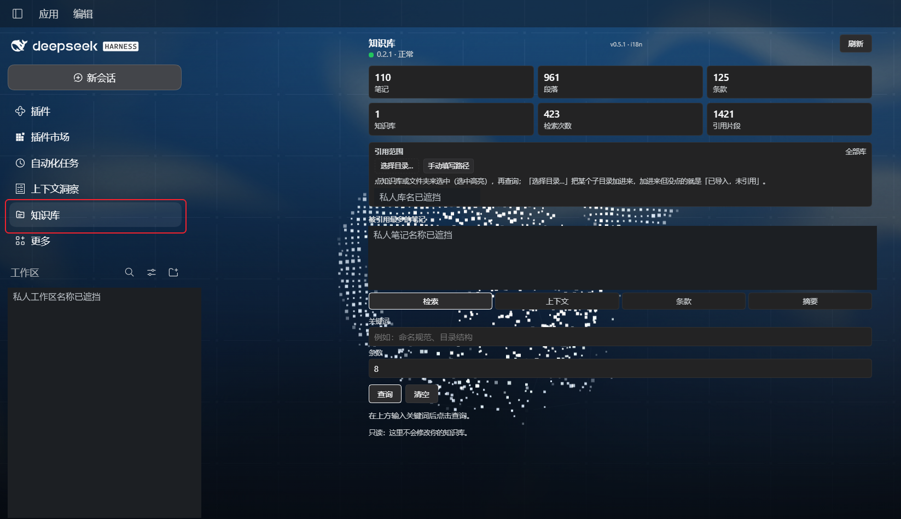

# Obsidian Quote · DeepSeek Harness panel

Adds a knowledge-base sidebar to DeepSeek Harness. It queries a **separately installed local Obsidian desktop service** over authenticated loopback HTTP. The panel itself does not install Obsidian, read every folder on your computer, or create a hosted knowledge base.

为 DeepSeek Harness 提供知识库侧栏：选择已登记的库或子目录，只读检索笔记片段、生成带来源的上下文、提取条款、生成项目规范摘要并查看共享引用统计。

## Prerequisite / 前提

Install and enable **Vault Quote** in Obsidian (previously named **Obsidian Quote**). Register the vaults you want to search, enable the local service, and click **写入接入配置**. Keep that Obsidian instance running. The panel reuses the existing local connection file; an already-working installation does not need a new token or a reinstallation.

Obsidian **Vault Quote 0.2.8** 已完成自动审核；截至 2026-11-06 22:37（台北时间），官方导出数据已收录，但桌面端使用的 GitHub 镜像尚未同步，应用内仍可能搜索不到。官网按钮启用不代表桌面目录已更新，具体排查见[上架与目录同步说明](https://github.com/kleinklein0824/dsh-obsidian-quote/blob/main/docs/OBSIDIAN-SUBMISSION.md)。同步前可用 0.2.8 Release 的 `main.js`、`manifest.json`、`styles.css` 手动安装；已有可用服务和 Harness 面板无需重新部署。已有旧 ID 的配置迁移也见上述说明。

## Install / 安装

Use the prebuilt package in your Harness plugin manager, or run the host's CLI for your actual profile:

```text
dsh plugin --profile web add https://github.com/kleinklein0824/dsh-obsidian-quote/releases/download/v0.2.7/dsh-obsidian-quote-panel-0.5.1.tgz
```

`web` is an example profile; use the profile you actually run. The tarball contains this package at its root, including `package.json`, `index.js`, `client.js`, `cordis.patch.yml`, locales and the icon. It requires the Harness services declared in `dsh.client.inject`.

已通过本地目录安装的用户，继续使用现有 `harness-plugin/` 和 profile 即可。面板运行代码仍为 **0.5.1**，本次只补充商店说明与截图，**不用重新部署**。Obsidian 的新市场 ID 不改变共享的 `~/.obsidian-quote/config.json`、HTTP API、六个 MCP 工具或已有连接令牌。

## Use / 使用

Click **知识库** in the left rail, or open the right-sidebar knowledge tab. Choose a registered source, then use search, context, rules, brief or statistics. Vault registration and include/exclude settings are managed in Obsidian. Search is local keyword retrieval; sending retrieved text to a model follows your AI client's settings.



The screenshot shows panel **0.5.1** and the author's existing service **0.2.1**. Component version numbers are independent. This is the actual DeepSeek panel; Codex uses a separate adapter and interface.

完整[安装与使用指南](https://github.com/kleinklein0824/dsh-obsidian-quote/blob/main/docs/HARNESS-USAGE.md)、[Codex 与 DeepSeek 的实际面板](https://github.com/kleinklein0824/dsh-obsidian-quote#不同-harness-安装后的实际面板)、[1080p 演示视频](https://github.com/kleinklein0824/dsh-obsidian-quote/releases/download/v0.2.7/Obsidian-Quote-promo-1080p.mp4)。视频为项目介绍，部分画面为演示设计，实际功能与入口以文档和真实截图为准。

MIT · Klein
